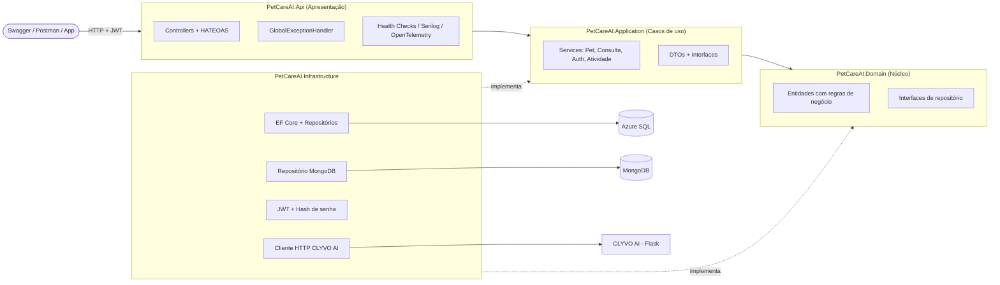
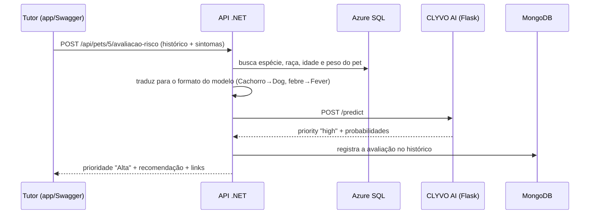
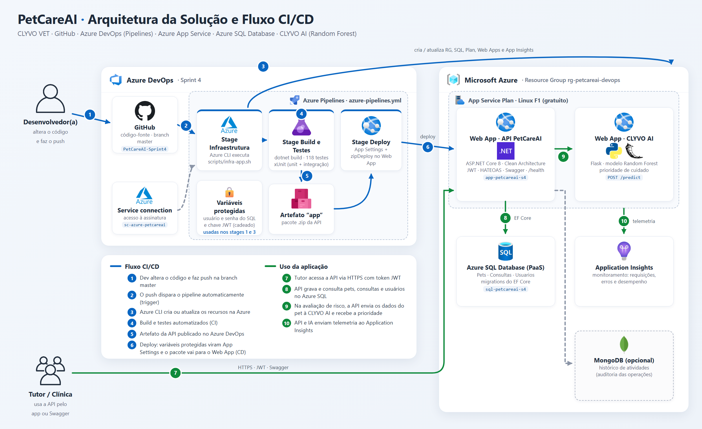

# PetCareAI - API de Gestão de Pets 🐾 (CLYVO VET)

API RESTful em **ASP.NET Core 8** para clínicas veterinárias e tutores: cadastro de pets, agendamento de consultas, autenticação JWT, histórico de atividades e **avaliação de prioridade de cuidado com IA (CLYVO AI)**. Projeto da **Sprint 4** do Challenge 2026 (Análise e Desenvolvimento de Sistemas, FIAP).

| Repositório | Conteúdo |
|---|---|
| [PetCareAI-Sprint4](https://github.com/brunovb002/PetCareAI-Sprint4) (este) | API .NET, testes, pipeline CI/CD e infraestrutura |
| [petcareai-clyvo-ai](https://github.com/brunovb002/petcareai-clyvo-ai) | Modelo de IA (Python, Random Forest) exposto como API Flask |

---

## 👥 Integrantes

| Nome | RM | Turma |
|---|---|---|
| Bruno Vinicius Barbosa | RM 566366 | 2TDS |
| Guilherme de Andrade Martini | RM 566087 | 2TDS |
| Nathan Gonçalves Pereira Mendes | RM 564666 | 2TDS |
| Raphael Gomes Mancera | RM 562279 | 2TDS |

---

## 📌 Visão geral

O **PetCareAI** centraliza o histórico de saúde dos pets de uma clínica veterinária:

- **Tutores e veterinários** se cadastram e fazem login (JWT).
- **Pets** são cadastrados vinculados ao tutor logado.
- **Consultas** são agendadas para um pet, com veterinário, motivo e diagnóstico.
- Cada criação, alteração ou remoção gera um registro no **histórico de atividades** (auditoria), guardado no MongoDB.
- O tutor relata os sintomas do pet e a **CLYVO AI** indica a prioridade de cuidado (**Alta**, **Média** ou **Baixa**) com uma recomendação.

**Benefício para o negócio:** sem fichas de papel ou planilhas soltas, qualquer atendimento consulta o histórico completo do animal em segundos, e a clínica sabe quem alterou cada informação e quando. Com a avaliação da IA, o tutor sabe quando procurar atendimento antes de o problema se agravar, e a clínica recebe primeiro os casos mais urgentes.

---

## 🏛️ Arquitetura (Clean Architecture)

A solução é dividida em 4 projetos. As dependências apontam sempre **para dentro**: o Domínio não conhece ninguém, e a Infraestrutura implementa as interfaces definidas nas camadas internas (Inversão de Dependência).



| Projeto | Responsabilidade |
|---|---|
| `PetCareAI.Domain` | Entidades (`Pet`, `Consulta`, `Usuario`, `RegistroAtividade`) que validam as próprias regras, exceções de domínio, interfaces de repositório e modelos de paginação/filtro. Sem dependências externas. |
| `PetCareAI.Application` | Serviços (casos de uso), DTOs, mapeamentos e as portas `ISenhaHasher` e `ITokenService`. Depende só do Domínio. |
| `PetCareAI.Infrastructure` | `AppDbContext` + Fluent API + migrations, repositórios EF Core, repositório MongoDB, geração de JWT, hash de senha (PBKDF2 do ASP.NET Core Identity) e cliente HTTP da CLYVO AI. |
| `PetCareAI.Api` | Controllers REST, HATEOAS, tratamento global de exceções (ProblemDetails), autenticação, Swagger, health checks, logs e métricas. |

**Princípios aplicados:**
- **SOLID**: serviços com interface (`IPetService`…) e uma responsabilidade cada; repositórios atrás de interfaces (D); entidades fechadas para alteração direta, com setters privados e métodos como `Atualizar()`.
- **Injeção de dependência**: cada camada expõe seu registro (`AddApplication()`, `AddInfrastructure()`), e o `Program.cs` só compõe.
- **Tratamento global de exceções**: `GlobalExceptionHandler` (`IExceptionHandler`) converte exceções em respostas `application/problem+json` (RFC 7807): `DomainException` → 400, `NotFoundException` → 404, `ConflictException` → 409, credenciais inválidas → 401, IA fora do ar → 503, qualquer outra → 500 sem expor detalhes internos. Os controllers não têm `try/catch`.

---

## 🛠️ Tecnologias

- **C# 12 / .NET 8** (ASP.NET Core Web API)
- **Entity Framework Core 8** + **SQL Server / Azure SQL** (migrations)
- **MongoDB** (driver oficial) para o histórico de atividades
- **JWT Bearer** + `PasswordHasher` do ASP.NET Core Identity
- **Swagger / OpenAPI** (Swashbuckle) com botão *Authorize*
- **Serilog** (logs estruturados, arquivo em JSON), **OpenTelemetry** (métricas Prometheus), **Health Checks**
- **xUnit**, **Moq**, **FluentAssertions**, **WebApplicationFactory**, **coverlet**

---

## 🔗 Endpoints

Todos os endpoints, exceto `registrar`, `login` e os de health, exigem o header `Authorization: Bearer <token>`.

### Autenticação
| Método | Rota | Descrição |
|---|---|---|
| POST | `/api/auth/registrar` | Cadastra usuário (`Tutor` ou `Veterinario`) |
| POST | `/api/auth/login` | Retorna o token JWT |
| GET | `/api/auth/eu` | Dados do usuário logado |

### Pets
| Método | Rota | Descrição |
|---|---|---|
| GET | `/api/pets` | Lista paginada. Filtros: `nome`, `especie`, `usuarioId`. Ordenação: `ordenarPor` = `id`, `nome`, `especie`, `idade`, `peso`; `direcao` = `asc` ou `desc` |
| GET | `/api/pets/{id}` | Busca por ID |
| POST | `/api/pets` | Cadastra (vinculado ao usuário logado) |
| PUT | `/api/pets/{id}` | Atualiza |
| DELETE | `/api/pets/{id}` | Remove (e as consultas do pet) |
| GET | `/api/pets/{id}/consultas` | Consultas do pet (paginado) |
| POST | `/api/pets/{id}/avaliacao-risco` | **CLYVO AI**: prioridade de cuidado a partir dos sintomas (ver abaixo) |

### Consultas
| Método | Rota | Descrição |
|---|---|---|
| GET | `/api/consultas` | Lista paginada. Filtros: `petId`, `veterinario`, `dataInicio`, `dataFim`. Ordenação: `id`, `data`, `veterinario` |
| GET | `/api/consultas/{id}` | Busca por ID |
| POST | `/api/consultas` | Agenda (o pet precisa existir) |
| PUT | `/api/consultas/{id}` | Atualiza |
| DELETE | `/api/consultas/{id}` | Remove |

### Histórico de atividades (MongoDB)
| Método | Rota | Descrição |
|---|---|---|
| GET | `/api/atividades` | Auditoria, da mais recente para a mais antiga. Filtros: `entidade` (`Pet`, `Consulta`), `acao` (`Criacao`, `Atualizacao`, `Remocao`), `entidadeId` |

### Observabilidade
| Rota | Descrição |
|---|---|
| `/health` | Status da API, do Azure SQL e do MongoDB (JSON) |
| `/health/live` | Só a API (liveness) |
| `/metrics` | Métricas no formato Prometheus |
| `/swagger` | Documentação interativa (a raiz `/` redireciona para cá) |

### Paginação + HATEOAS: exemplo

`GET /api/pets?especie=Gato&ordenarPor=nome&pagina=1&tamanhoPagina=2`

```json
{
  "itens": [
    {
      "dados": { "id": 2, "nome": "Mimi", "especie": "Gato", "raca": "Siamês", "idade": 2, "peso": 4.2, "usuarioId": 1 },
      "links": [
        { "href": "https://.../api/pets/2", "rel": "self", "metodo": "GET" },
        { "href": "https://.../api/pets/2", "rel": "atualizar", "metodo": "PUT" },
        { "href": "https://.../api/pets/2", "rel": "remover", "metodo": "DELETE" },
        { "href": "https://.../api/pets/2/consultas", "rel": "consultas", "metodo": "GET" }
      ]
    }
  ],
  "paginacao": { "pagina": 1, "tamanhoPagina": 2, "totalItens": 3, "totalPaginas": 2 },
  "links": [
    { "href": "https://.../api/pets?pagina=1&tamanhoPagina=2&especie=Gato&ordenarPor=nome", "rel": "self", "metodo": "GET" },
    { "href": "https://.../api/pets?pagina=2&tamanhoPagina=2&especie=Gato&ordenarPor=nome", "rel": "proxima", "metodo": "GET" }
  ]
}
```

O tamanho de página vai de 1 a 50 (padrão 10).

---

## 🤖 Integração com a IA (CLYVO AI)

A CLYVO AI é um modelo **Random Forest** (Python/scikit-learn, repositório [petcareai-clyvo-ai](https://github.com/brunovb002/petcareai-clyvo-ai)) que classifica a prioridade de cuidado do pet. Ele roda como um serviço Flask separado, e esta API faz a ponte entre o tutor, o banco e o modelo:



**Requisição:**

```json
{
  "historicoMedico": "DoencaCronica",
  "sintomas": ["dificuldade para respirar", "febre", "fraqueza"]
}
```

`historicoMedico` aceita: `SemCondicoesPrevias`, `Vacinado`, `NaoVacinado`, `Alergias`, `ProblemasDentarios`, `HistoricoDeParasitas`, `HistoricoDePele`, `CirurgiaRecente`, `DoencaRenalPrevia`, `CardiopatiaPrevia`, `DoencaCronica`.

**Resposta:**

```json
{
  "dados": {
    "petId": 5,
    "prioridade": "Alta",
    "confianca": 0.88,
    "recomendacao": "Procure atendimento veterinário o quanto antes.",
    "sintomasNaoReconhecidos": [],
    "avaliadoEm": "2026-11-04T13:00:00Z"
  },
  "links": [ { "href": "https://.../api/pets/5", "rel": "pet", "metodo": "GET" } ]
}
```

**Como a API trata os dados:**
- O modelo foi treinado com um dataset em inglês. A classe `ClyvoAiTraducao` converte espécie, raça, histórico e sintomas, sem diferenciar acentos e procurando o termo dentro do texto ("febre alta há 2 dias" vira `Fever`).
- Sintomas que não estão no dicionário seguem como foram digitados (o modelo os trata como leves) e aparecem em `sintomasNaoReconhecidos`.
- O modelo só conhece **cães e gatos**. Para outras espécies a API responde 400.
- Se o serviço de IA estiver fora do ar, a API responde **503** e o resto do sistema continua funcionando.

**Resultados com o modelo real** (chamadas da API ao serviço Flask):

| Pet | Sintomas | Prioridade |
|---|---|---|
| Cachorro Labrador, 11 anos, doença crônica | dificuldade para respirar, fraqueza, febre, letargia, dor | **Alta** (88%) |
| Gato Persa, 9 anos, doença renal prévia | perda de apetite, perda de peso, fraqueza | **Média** (65%) |
| Gato Siamês, 2 anos, sem condições prévias | espirros | **Baixa** (100%) |

**Limitação conhecida:** o modelo considera sempre 5 sintomas. Quando o tutor informa menos, os que faltam contam como leves, então relatos curtos tendem a sair com prioridade menor. Um próximo passo é retreinar o modelo considerando a quantidade de sintomas informados.

---

## 💾 Persistência

**Relacional (Azure SQL / SQL Server via EF Core):** tabelas `Pets`, `Consultas` (FK com *cascade delete*) e `Usuarios` (e-mail único). As migrations ficam em `src/PetCareAI.Infrastructure/Persistence/Migrations` e são aplicadas automaticamente quando a API inicia:
- `InitialCreate`: Pets e Consultas
- `Sprint4_UsuariosEValidacoes`: tabela Usuarios, limites de tamanho das colunas e índices

**NoSQL (MongoDB):** coleção `atividades` com um documento por operação (`entidade`, `entidadeId`, `acao`, `usuarioId`, `descricao`, `dataHora`). Foi escolhido NoSQL porque é um log de esquema flexível, só de inserção e sem relacionamentos. Se o MongoDB ficar fora do ar, a operação principal no SQL **não falha**: o erro vai para o log.

---

## 🔐 Configuração e segredos

**Nenhum segredo fica no `appsettings.json`.** Os valores vêm de variáveis de ambiente (na Azure, App Settings do Web App alimentadas pelo pipeline) ou do *user-secrets* em desenvolvimento.

| Chave | Variável de ambiente | Obrigatória |
|---|---|---|
| `ConnectionStrings:DefaultConnection` | `ConnectionStrings__DefaultConnection` | Sim |
| `Jwt:Key` (mín. 32 caracteres) | `Jwt__Key` | Sim (a API não sobe sem ela) |
| `MongoDb:ConnectionString` | `MongoDb__ConnectionString` | Não (sem ela, o histórico fica desativado e vai um aviso para o log) |
| `ClyvoAi:Url` | `ClyvoAi__Url` | Não (sem ela, a avaliação de risco responde 503) |

---

## 🚀 Como executar localmente

**Pré-requisitos:** [.NET 8 SDK](https://dotnet.microsoft.com/download/dotnet/8.0), um SQL Server (local, Docker ou Azure SQL) e, se quiser, um MongoDB.

```bash
git clone https://github.com/brunovb002/PetCareAI-Sprint4.git
cd PetCareAI-Sprint4
```

Configure os segredos (ficam fora do repositório):

```bash
cd src/PetCareAI.Api
dotnet user-secrets set "ConnectionStrings:DefaultConnection" "Server=localhost,1433;Database=petcareai;User ID=sa;Password=<sua-senha>;TrustServerCertificate=True"
dotnet user-secrets set "Jwt:Key" "<uma-chave-aleatoria-com-32-ou-mais-caracteres>"
dotnet user-secrets set "MongoDb:ConnectionString" "mongodb://localhost:27017"
dotnet user-secrets set "ClyvoAi:Url" "http://localhost:5000"
cd ../..
```

Para a avaliação de risco, suba também o serviço de IA (instruções no repositório [petcareai-clyvo-ai](https://github.com/brunovb002/petcareai-clyvo-ai)): `python app.py`.

Rode a API (as migrations são aplicadas sozinhas):

```bash
dotnet run --project src/PetCareAI.Api --environment Development
```

Abra o endereço que aparecer no terminal + `/swagger`. Fluxo no Swagger:
1. `POST /api/auth/registrar`
2. `POST /api/auth/login` e copie o `token`
3. Clique em **Authorize**, cole o token e use os demais endpoints

---

## 🧪 Testes

São 100 testes (xUnit, todos no padrão **Arrange / Act / Assert**):

| Projeto | O que cobre |
|---|---|
| `tests/PetCareAI.Tests.Unit` (75) | **Domínio**: validações de `Pet`, `Consulta`, `Usuario`, paginação. **Aplicação**: `PetService`, `ConsultaService`, `AuthService`, `AtividadeService`, `AvaliacaoRiscoService` e a tradução para a IA, com Moq |
| `tests/PetCareAI.Tests.Integration` (25) | API real em memória (`WebApplicationFactory` + EF InMemory + Mongo e IA fakes): CRUD completo de pets e consultas, avaliação de risco, JWT (401 sem token, login inválido), paginação/filtros/ordenação, links HATEOAS, ProblemDetails 400/404/409, health checks e Swagger |

```bash
dotnet test PetCareAI.sln
```

Cobertura das camadas de Domínio e Aplicação (≈93% e ≈95% das linhas):

```bash
dotnet test tests/PetCareAI.Tests.Unit --collect:"XPlat Code Coverage"
```

---

## ☁️ DevOps: CI/CD no Azure DevOps

**Stack em nuvem:** Azure DevOps (Repos + Pipelines), Azure App Service Linux (API .NET 8), Azure SQL Database (PaaS), Application Insights e o serviço CLYVO AI em um segundo Web App (Python).



O pipeline [`azure-pipelines.yml`](azure-pipelines.yml) dispara **a cada push na branch `master`** e roda 3 stages em sequência:

| Stage | O que faz |
|---|---|
| **1. Infraestrutura** | Executa [`scripts/infra-app.sh`](scripts/infra-app.sh) com o Azure CLI: Resource Group, Azure SQL (servidor, banco e firewall), Application Insights, App Service Plan e Web App. Se o recurso já existe, é mantido. |
| **2. BuildTestes (CI)** | Restore, build, **testes unitários e de integração** (resultados na aba *Tests*), `dotnet publish` e publicação do artefato **`app`**. |
| **3. Deploy (CD)** | Baixa o artefato, grava a **connection string** e as variáveis no App Service e faz o deploy no **Azure Web App**. Só roda se o CI passar. |

Infraestrutura e deploy acontecem na **mesma execução**, sem passos manuais.

### Variáveis do pipeline

Os dados sensíveis ficam como **variáveis secretas** (cadeado) em *Pipelines → Edit → Variables* e chegam à aplicação como configuração do App Service. Nenhum segredo fica no código ou no `appsettings.json`.

| Variável | Secreta | Uso |
|---|---|---|
| `SQL_ADMIN_USER` | ✅ | Usuário administrador do Azure SQL |
| `SQL_ADMIN_PASSWORD` | ✅ | Senha do Azure SQL |
| `JWT_KEY` | ✅ | Chave de assinatura dos tokens (mín. 32 caracteres) |
| `webAppName`, `sqlServer`, `sqlDatabase`, `clyvoAiUrl` | - | Nomes dos recursos (no próprio YAML) |

### Configuração do projeto no Azure DevOps

1. Criar o projeto **Sprint 4 – Azure DevOps** (Private, Git, Scrum) e convidar o professor com acesso **Basic**.
2. **Repos → Import** deste repositório.
3. **Project Settings → Service connections → Azure Resource Manager** com o nome `MyAzureSubscription`.
4. **Pipelines → New pipeline → Azure Repos Git → Existing YAML file** → `/azure-pipelines.yml`.
5. Cadastrar as variáveis secretas da tabela acima e executar.

### Acesso ao banco pela ferramenta gráfica

Para consultar o Azure SQL pelo Azure Data Studio ou SSMS, libere o seu IP no firewall do servidor:

```bash
az sql server firewall-rule create --resource-group rg-petcareai-devops --server sql-petcareai-566366v2 --name MeuIP --start-ip-address <seu-ip> --end-ip-address <seu-ip>
```
